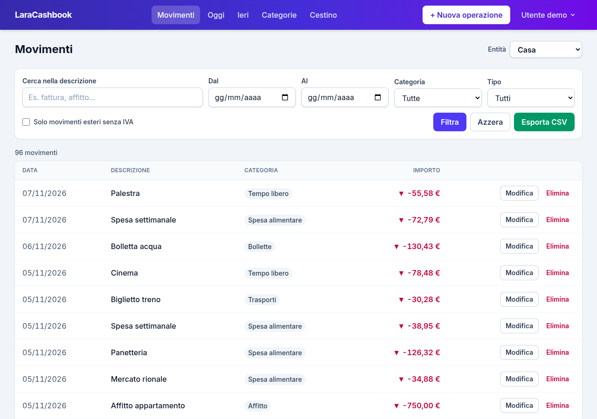
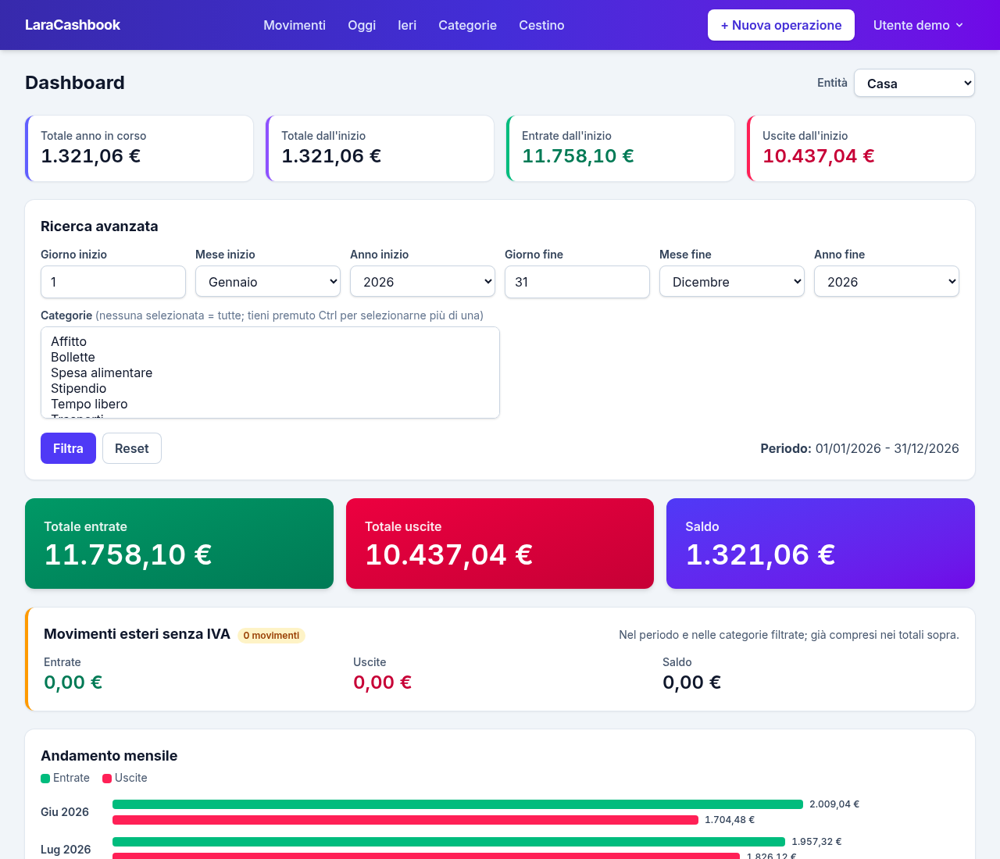
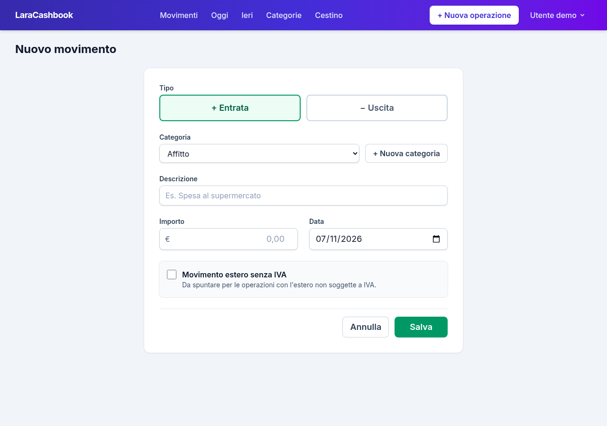
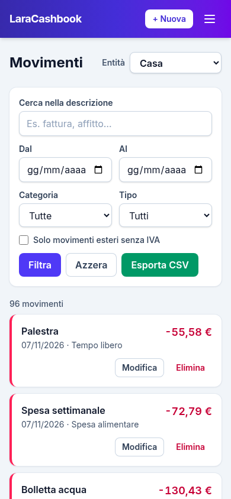

<p align="center"></p>

# LaraCashbook

[English](README.md) · **Italiano**

[](LICENSE)
[](https://www.php.net/)
[](https://laravel.com/)

**Sito:** [laracashbook.it](https://laracashbook.it) · **Demo online:** [demo.laracashbook.it](https://demo.laracashbook.it) (`demo@example.com` / `password`, password della dashboard `demo`)

Un libro cassa semplice, da installare sul proprio server, fatto con Laravel. Registra entrate e
uscite di una o più entità (la famiglia, l'attività, un cliente…), raggruppale per categoria e
guarda dove vanno i soldi.



> L'interfaccia è disponibile in **italiano** e in **inglese**: imposta `APP_LOCALE=it` nel `.env`
> (la lingua predefinita è l'inglese).

## Funzionalità

- **Movimenti**: inserimento, modifica ed eliminazione di entrate e uscite, con data, categoria e descrizione.
- **Filtri**: ricerca nel testo, periodo, categoria, entrate/uscite, più le scorciatoie Oggi e Ieri.
- **Export CSV** dei movimenti filtrati, pronto per Excel in italiano (separatore `;` e virgola decimale).
- **Cestino**: i movimenti eliminati si possono ripristinare o eliminare definitivamente.
- **Categorie** per entità. Una categoria può essere segnata come *estero senza IVA*: i nuovi movimenti di quella categoria hanno già il flag spuntato.
- **Più entità**: ogni utente vede solo le entità a cui è associato e può sceglierne una predefinita, selezionata a ogni accesso.
- **Dashboard** protetta da una password aggiuntiva: totali, filtri per periodo e categorie, andamento mensile e riepilogo per categoria.
- **Logo** e nome dell'applicazione configurabili.
- **Interfaccia in italiano e in inglese**, con dati di esempio in entrambe le lingue.
- Layout responsive (Tailwind CSS 4), comodo anche da telefono.

| Dashboard | Nuovo movimento | Telefono |
|---|---|---|
|  |  |  |

## Requisiti

- PHP 8.2 o superiore, Composer
- MySQL o MariaDB
- Node.js 20.19+ e npm, per compilare gli asset

## Installazione

Con Composer:

```bash
composer create-project faghy/laracashbook mio-libro-cassa
cd mio-libro-cassa
```

con l'installer di Laravel:

```bash
laravel new mio-libro-cassa --using=faghy/laracashbook
cd mio-libro-cassa
```

oppure da GitHub:

```bash
git clone https://github.com/faghy/laracashbook.git mio-libro-cassa
cd mio-libro-cassa
composer install
cp .env.example .env
php artisan key:generate
```

Poi:

1. Crea un database vuoto e imposta le variabili `DB_*` nel `.env`.
2. Imposta `APP_LOCALE=it` per l'interfaccia in italiano.
3. Imposta `PASSWORD_PROTECT` nel `.env`: è la password aggiuntiva che apre la dashboard
   (finché è vuota la dashboard resta chiusa).
4. Crea le tabelle, compila gli asset e avvia l'applicazione:

   ```bash
   php artisan migrate
   npm install && npm run build
   php artisan serve
   ```

5. Crea il primo utente. Le entità indicate vengono create se non esistono:

   ```bash
   php artisan cashbook:create-user --name="Mario Rossi" --email=mario@example.com --entity=Casa --entity=Studio
   ```

Apri http://127.0.0.1:8000 e accedi.

### Dati di esempio

Per provare l'applicazione con dei dati di esempio (un utente demo, due entità con le loro
categorie e circa sei mesi di movimenti, nella lingua impostata in `APP_LOCALE`):

```bash
php artisan migrate --seed
```

Accedi come `demo@example.com` con la password `password`. Usa i dati di esempio solo in
un'installazione di prova: chiunque conosca queste credenziali può entrare.

### Area amministratore

All'indirizzo `/admin` c'è una piccola area amministratore. Per crearne l'account imposta
`ADMIN_SEED_EMAIL` e `ADMIN_SEED_PASSWORD` nel `.env` e lancia:

```bash
php artisan db:seed --class=AdminUserSeeder
```

## Configurazione

| Variabile | Uso |
|---|---|
| `APP_NAME` | Nome mostrato nella barra di navigazione, nella pagina di accesso e nella scheda del browser. |
| `APP_LOCALE` | Lingua dell'interfaccia: `en` (predefinita) o `it`. Il formato degli importi e del CSV la segue. |
| `CASHBOOK_LOGO_URL` | Logo accanto al nome: un URL completo o un percorso dentro `public/`, ad esempio `/images/logo.svg`. Vuoto = nessun logo. La barra di navigazione è scura: usa una versione chiara. |
| `CASHBOOK_LOGO_ALT` | Testo alternativo del logo. |
| `PASSWORD_PROTECT` | Password aggiuntiva della dashboard. |
| `DEMO_MODE` | `true` per una demo pubblica: mostra le credenziali di prova (`demo@example.com` / `password` e la password della dashboard) e blocca le modifiche all'account e il recupero password. |
| `ADMIN_SEED_NAME`, `ADMIN_SEED_EMAIL`, `ADMIN_SEED_PASSWORD` | Account creato da `AdminUserSeeder`. |

Ogni utente ha un ruolo (`stagista`, `operatore` o `responsabile`), da impostare con `--role` su
`cashbook:create-user`; il predefinito è `responsabile`. Gli utenti `stagista` non vedono i totali
generali nella dashboard.

## Pubblicazione

Va bene qualsiasi hosting che esegue Laravel (hosting condiviso con SSH, Plesk, Forge, un VPS…).
Fai puntare la radice del sito alla cartella `public/` e compila gli asset con `npm run build`
(la cartella `public/build` non è versionata). Dopo ogni aggiornamento lancia:

```bash
php artisan migrate --force
php artisan config:cache
php artisan view:clear
```

## Test

I test usano un database MySQL/MariaDB dedicato chiamato `laracashbook_test` (vedi `phpunit.xml`),
che viene svuotato a ogni esecuzione. Per sicurezza i test si rifiutano di partire se il nome del
database non finisce con `_test`. Girano con l'interfaccia in italiano; `LocaleTest` verifica
l'inglese.

```bash
# crea una volta il database laracashbook_test, poi:
php artisan test
# host o credenziali diversi dal .env:
DB_HOST=127.0.0.1 DB_PORT=3306 DB_USERNAME=utente DB_PASSWORD=segreta php artisan test
```

Stile del codice: `vendor/bin/pint`.

## Contribuire

Segnalazioni e pull request sono benvenute su [GitHub](https://github.com/faghy/laracashbook/issues).
Prima di aprire una pull request lancia `php artisan test` e `vendor/bin/pint`.

## Licenza

LaraCashbook è software libero distribuito con [licenza MIT](LICENSE).
