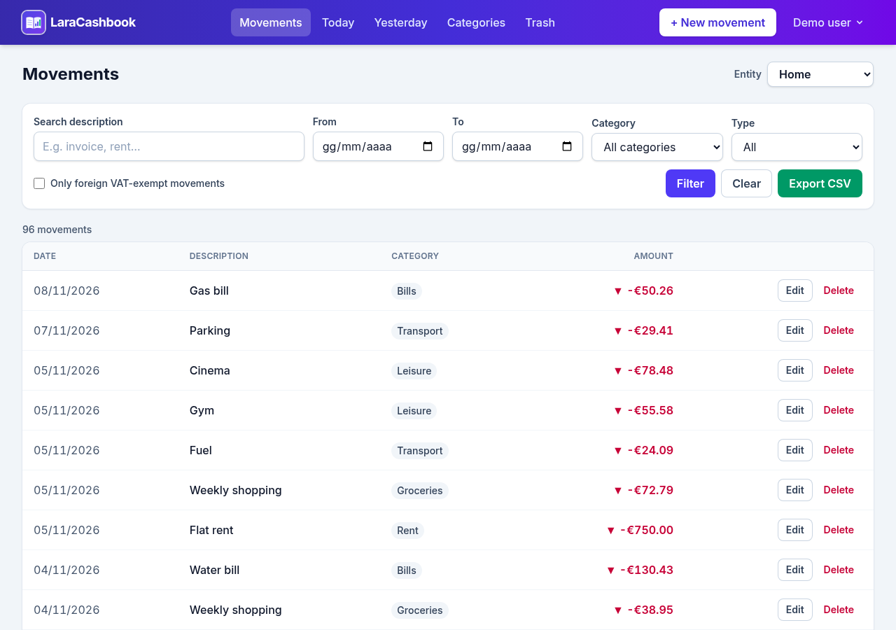
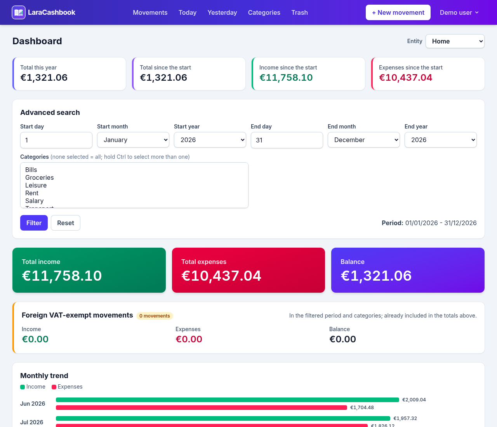
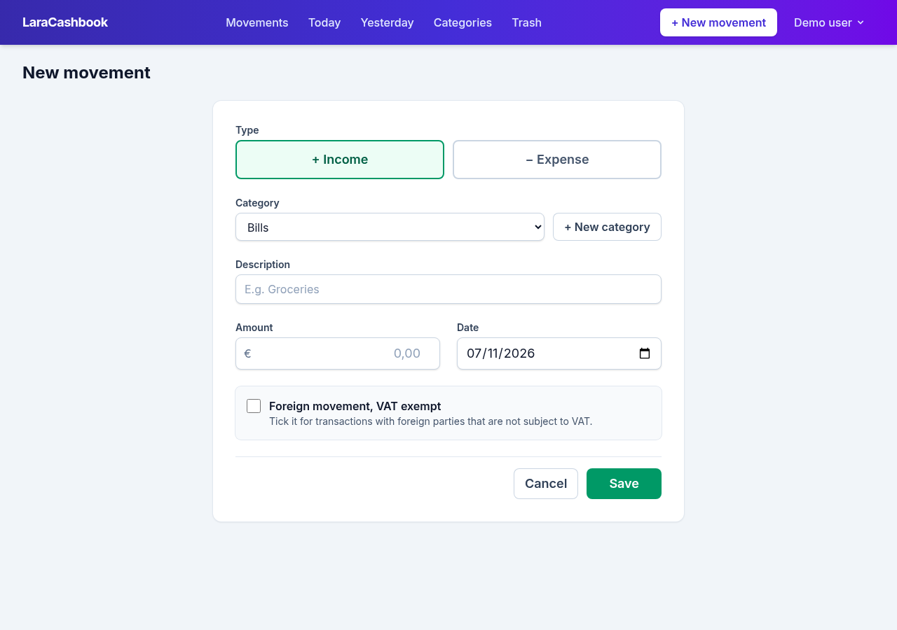
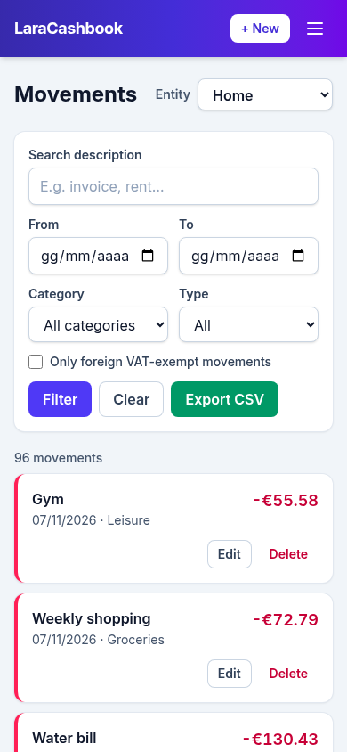

<p align="center"></p>

# LaraCashbook

**English** · [Italiano](README.it.md)

[](LICENSE)
[](https://www.php.net/)
[](https://laravel.com/)

**Website:** [laracashbook.it](https://laracashbook.it) · **Live demo:** [demo.laracashbook.it](https://demo.laracashbook.it) (`demo@example.com` / `password`, dashboard password `demo`)

A simple, self-hosted cash book built with Laravel. Record income and expenses for one or more
entities (your household, your business, a client…), group them into categories and see where the
money goes.



> The interface is available in **English** and **Italian** (`APP_LOCALE=en` or `it`). Pull requests adding more languages are welcome: copy `lang/it.json` to `lang/<code>.json` and translate it.

## Features

- **Movements**: add, edit and delete income and expenses, with date, category and description.
- **Filters**: free-text search, date range, category, income/expense, plus shortcuts for today and yesterday.
- **CSV export** of the filtered movements, ready for Excel (in Italian: `;` separator and decimal comma).
- **Trash**: deleted movements can be restored or removed for good.
- **Categories** per entity, with defaults for new movements: income or expense, and the *foreign, VAT exempt* flag. To delete a category that still has movements, move them (one by one, the selected ones or all) to another category first.
- **Multiple entities**: each user only sees the entities they belong to and can pick a default one, selected at every login.
- **Dashboard** behind an extra password: totals, period and category filters, monthly trend and per-category summary.
- **Configurable logo** and application name; LaraCashbook logo and favicon by default.
- **English and Italian** interface, demo data included.
- **Security**: sign-in limited per email and per IP, password reset that does not reveal registered emails, security headers (HSTS, frame and content-type protection).
- Responsive layout (Tailwind CSS 4) that works well on phones.

| Dashboard | New movement | Mobile |
|---|---|---|
|  |  |  |

## Requirements

- PHP 8.3 or newer, Composer
- MySQL or MariaDB
- Node.js 20.19+ and npm, to build the assets

## Installation

With Composer:

```bash
composer create-project faghy/laracashbook my-cashbook
cd my-cashbook
```

with the Laravel installer:

```bash
laravel new my-cashbook --using=faghy/laracashbook
cd my-cashbook
```

or from GitHub:

```bash
git clone https://github.com/faghy/laracashbook.git my-cashbook
cd my-cashbook
composer install
cp .env.example .env
php artisan key:generate
```

Then:

1. Create an empty database and set `DB_*` in `.env`.
2. Set `PASSWORD_PROTECT` in `.env`: it is the extra password that opens the dashboard
   (while it is empty the dashboard stays locked).
3. Create the tables, build the assets and start the app:

   ```bash
   php artisan migrate
   npm install && npm run build
   php artisan serve
   ```

4. Create your first user. The entities you name are created if they don't exist yet:

   ```bash
   php artisan cashbook:create-user --name="Mario Rossi" --email=mario@example.com --entity=Casa --entity=Studio
   ```

Open http://127.0.0.1:8000 and sign in.

### Demo data

To try the app with sample data instead (a demo user, two entities with their categories and about
six months of movements, in the language set by `APP_LOCALE`):

```bash
php artisan migrate --seed
```

Sign in as `demo@example.com` with the password `password`. Use the demo data only on a test
installation: anyone who knows these credentials can sign in.

### Admin area

There is a minimal admin area at `/admin`. To create its account, set `ADMIN_SEED_EMAIL` and
`ADMIN_SEED_PASSWORD` in `.env` and run:

```bash
php artisan db:seed --class=AdminUserSeeder
```

## Configuration

| Variable | Purpose |
|---|---|
| `APP_NAME` | Name shown in the navigation bar, on the sign-in page and in the browser tab. |
| `APP_LOCALE` | Interface language: `en` (default) or `it`. Amounts and the CSV format follow it. |
| `CASHBOOK_LOGO_URL` | Logo shown next to the name in the navigation bar and on the sign-in page: an absolute URL or a path in `public/` such as `/images/logo.svg`. Empty means the LaraCashbook logo, `none` means no logo. The navigation bar is dark, so use a light version. |
| `CASHBOOK_LOGO_ALT` | Alternative text for the logo (empty by default, since the name is shown next to it). |
| `PASSWORD_PROTECT` | Extra password for the dashboard. |
| `DEMO_MODE` | `true` for a public demo: shows the demo credentials (`demo@example.com` / `password` and the dashboard password) and blocks account changes and password resets. |
| `TRUSTED_PROXIES` | IP addresses of the reverse proxies in front of the app (comma separated, CIDR allowed), e.g. `10.0.0.200`. Needed behind a proxy or load balancer, otherwise every visitor has the proxy's IP and shares the same login limits. The proxy must send `X-Forwarded-For` with the visitor's IP. |
| `ADMIN_SEED_NAME`, `ADMIN_SEED_EMAIL`, `ADMIN_SEED_PASSWORD` | Account created by `AdminUserSeeder`. |

Users have a role (`stagista`, `operatore` or `responsabile`), set with `--role` on
`cashbook:create-user`; the default is `responsabile`. `stagista` users don't see the overall totals
on the dashboard.

## Deployment

Any host that runs Laravel works (shared hosting with SSH, Plesk, Forge, a VPS…). Point the web root
to `public/` and build the assets with `npm run build` (the `public/build` folder is not versioned).
After each update run:

```bash
php artisan migrate --force
php artisan config:cache
php artisan view:clear
```

## Tests

The tests use a dedicated MySQL/MariaDB database called `laracashbook_test` (see `phpunit.xml`),
which is emptied on every run. They run with the Italian interface; `LocaleTest` covers English. As a safeguard, they refuse to start if the database name does not
end with `_test`.

```bash
# create the laracashbook_test database once, then:
php artisan test
# different host or credentials from .env:
DB_HOST=127.0.0.1 DB_PORT=3306 DB_USERNAME=user DB_PASSWORD=secret php artisan test
```

Code style: `vendor/bin/pint`.

## Contributing

Bug reports and pull requests are welcome on [GitHub](https://github.com/faghy/laracashbook/issues).
Please run `php artisan test` and `vendor/bin/pint` before opening a pull request.

## License

LaraCashbook is open-source software licensed under the [MIT license](LICENSE).
